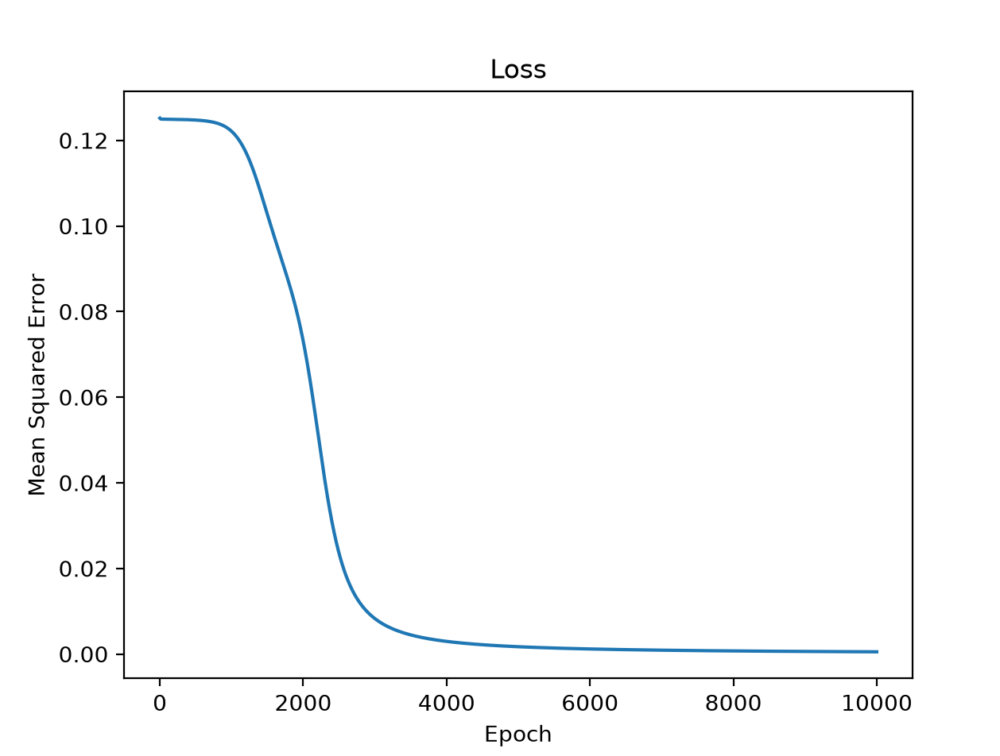

# Neural Logic Gates from Scratch

A progressive collection of neural network implementations built completely from first principles in Python, starting from single-layer linear gates with just pure python and scaling up to multi-layer perceptrons with NumPy.

---

## 📂 Repository Structure

* **`or_gate.py`** – A baseline single-layer perceptron solving a linearly separable OR problem.
* **`xor_python.py`** – A manual multi-layer perceptron built using pure Python data structures to tackle the non-linear XOR problem.
* **`xor_numpy.py`** – An optimized, vectorized NumPy multi-layer perceptron featuring `matplotlib` visualization for the loss function.

---

## 🧠 Core Architecture (`xor_numpy.py`)
* **Input Layer:** 2 nodes (representing binary inputs `[0,0]`, `[0,1]`, `[1,0]`, `[1,1]`)
* **Hidden Layer:** 2 nodes utilizing random uniform weight initialization and the sigmoid activation function
* **Output Layer:** 1 node yielding a final prediction squashed between `0` and `1`
* **Loss Function:** Mean Squared Error (MSE) tracking with manual gradient computation

---

## 📈 Training Dynamics

* **The Plateau Phase:** Early epochs exhibit a flat loss region near `0.125`, where the network initializes symmetrically and navigates local saddle points.
* **The Convergence Drop:** Once symmetry is broken, gradient descent rapidly accelerates, driving the mean squared error down near zero and consistently yielding the clean XOR truth table (`[0, 1, 1, 0]`).

---

## 🛠️ Engineering Hurdles & Debugging Log
Building this from scratch involved troubleshooting several critical milestones:
1. **Backpropagation Without NumPy:** Trying to write the backpropagation for each set of weights and biases in just 1 line without NumPy proved challenging, leading to poor readability and bugs in the calculation. Transitioning to NumPy in the 2nd version of the XOR gate taught me firsthand NumPy's utility and the power of linear algebra.
2. **Using ReLU in the Hidden Layer:** At first, I used the ReLU activation function in the hidden layer of the first version of the XOR gate for simplicity. However, when training the model, it was always wrong. That's when I did some digging and learned about how ReLU can kill neurons because it's derivative is 0 when the input is less than or equal to 0. I concluded that ReLU wasn't applicable in this neural network and switched to sigmoid as the optimal alternative.
3. **Symmetry Breaking:** Analyzing why random weight initializations occasionally trap the network in flat MSE loss plateaus (`0.125`), resulting in low accuracy. In a small network such as this one, encountering symmetry is unavoidable without certain optimizations.
---

## 🚀 Getting Started & How to Run

Clone the repository, install dependencies (`numpy` and `matplotlib`), and run any script in your terminal using:

```bash
git clone [https://github.com/your-username/neural-logic-gates.git](https://github.com/your-username/neural-logic-gates.git)
cd neural-logic-gates
pip install numpy matplotlib
python3 xor_numpy.py